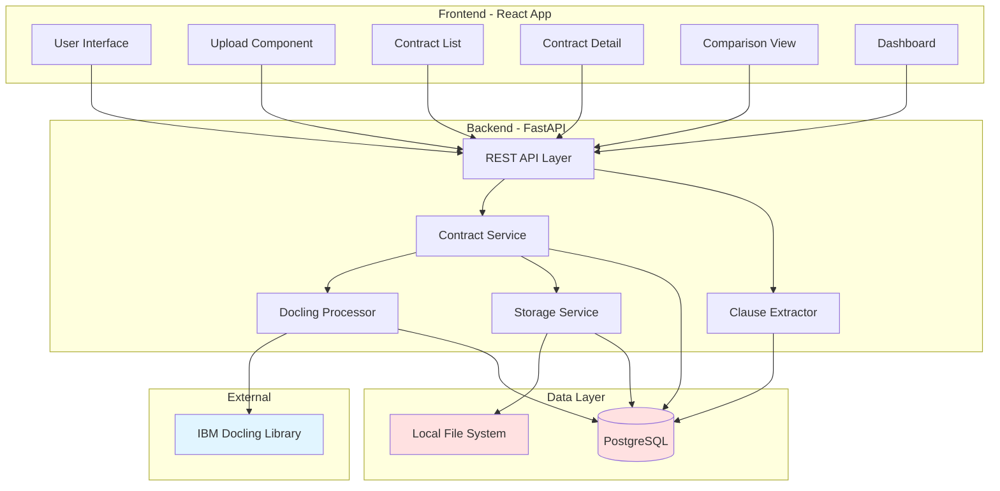
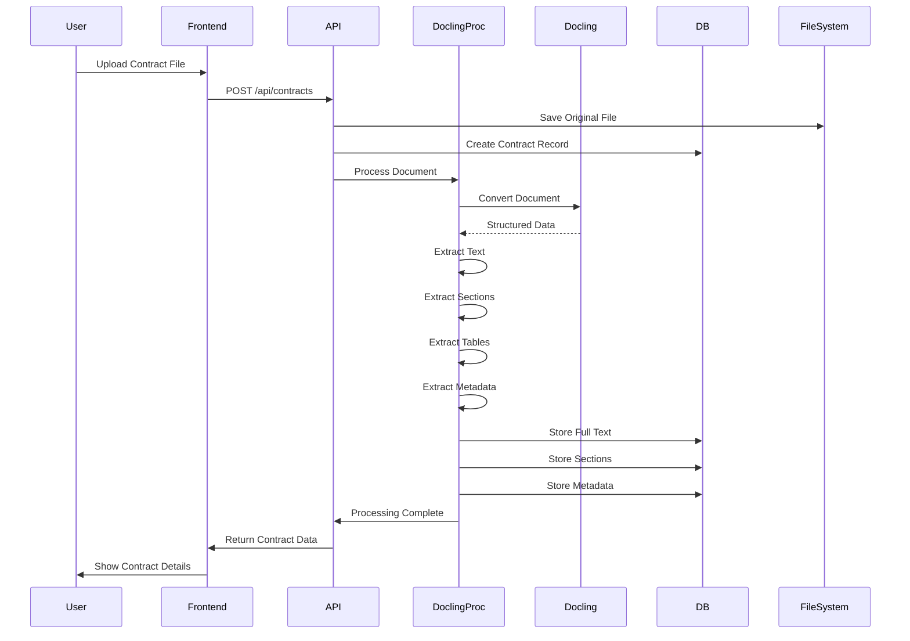
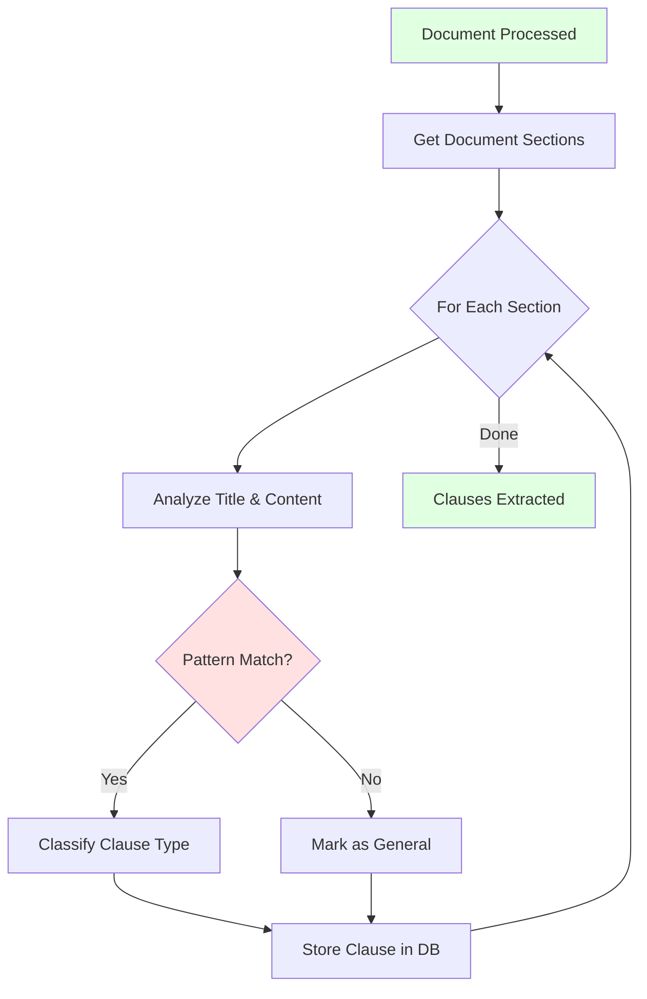
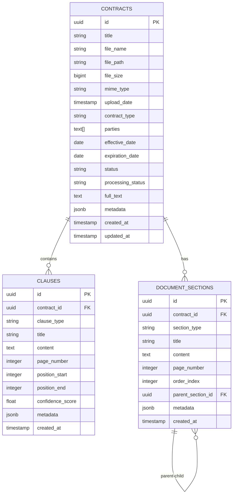
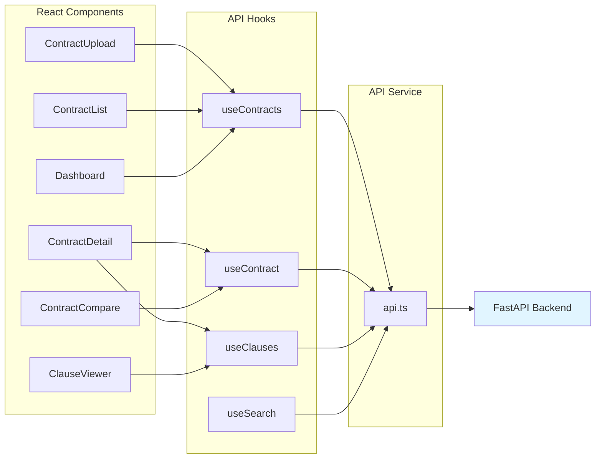
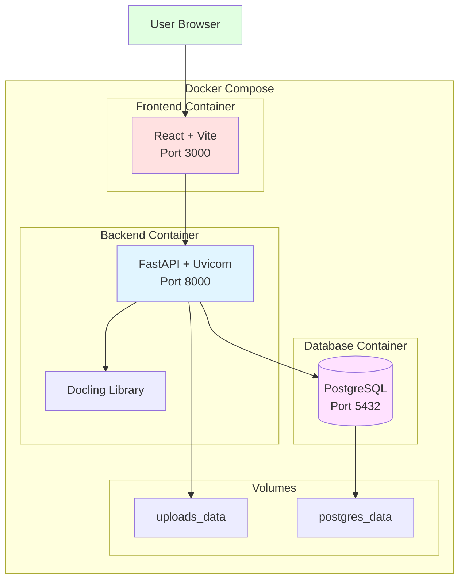
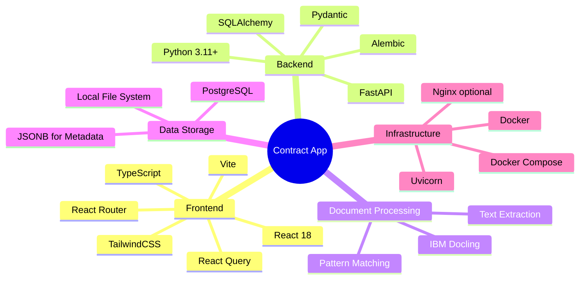

# Contract Analysis App - Architecture Overview

## System Architecture



## Document Processing Flow



## Clause Extraction Flow



## Data Model



## Component Interaction



## Deployment Architecture



## API Endpoint Structure

```mermaid
graph TD
    API[FastAPI Application]
    
    API --> Contracts[/api/contracts]
    API --> Clauses[/api/clauses]
    API --> Search[/api/search]
    
    Contracts --> C1[POST / - Upload]
    Contracts --> C2[GET / - List All]
    Contracts --> C3[GET /:id - Get One]
    Contracts --> C4[DELETE /:id - Delete]
    Contracts --> C5[PATCH /:id - Update]
    Contracts --> C6[GET /:id/clauses]
    Contracts --> C7[POST /:id/process]
    Contracts --> C8[GET /:id/download]
    
    Clauses --> CL1[GET /types - Statistics]
    
    Search --> S1[GET / - Search Contracts]
    
    style API fill:#e1f5ff
    style Contracts fill:#ffe1e1
    style Clauses fill:#ffe1e1
    style Search fill:#ffe1e1
```

## Technology Stack Overview



## Key Design Decisions

### 1. Offline-First Architecture
- All data stored locally (PostgreSQL + file system)
- No external API dependencies
- Can run completely disconnected from internet

### 2. IBM Docling for Extraction
- Replaces LLM-based extraction
- Provides structured document parsing
- Extracts text, tables, sections, metadata
- More reliable and faster than LLM calls

### 3. Rule-Based Clause Classification
- Pattern matching on section titles and content
- Predefined clause type patterns
- Confidence scoring based on match quality
- Extensible pattern dictionary

### 4. Simple REST API
- Standard CRUD operations
- JSON request/response
- File upload via multipart/form-data
- Pagination for list endpoints

### 5. React + TypeScript Frontend
- Type-safe development
- Component-based architecture
- React Query for server state
- TailwindCSS for rapid styling

### 6. Docker Compose for Development
- Single command to start all services
- Consistent development environment
- Easy onboarding for new developers
- Production-ready containerization

## Security Considerations

Even for local development, basic security is implemented:

1. **File Upload Validation**
   - File type checking (PDF, DOCX, TXT only)
   - File size limits (50MB default)
   - Sanitized file names

2. **SQL Injection Prevention**
   - SQLAlchemy ORM (parameterized queries)
   - Input validation with Pydantic

3. **Path Traversal Prevention**
   - Restricted upload directory
   - UUID-based file naming

4. **CORS Configuration**
   - Restricted to localhost origins
   - Configurable for production

## Performance Considerations

1. **Database Indexing**
   - Indexes on frequently queried fields
   - Full-text search on contract content
   - JSONB indexing for metadata queries

2. **File Storage**
   - Original files stored separately
   - Extracted text in database for fast search
   - Lazy loading of large content

3. **Frontend Optimization**
   - Code splitting with React Router
   - React Query caching
   - Virtualized lists for large datasets

4. **Processing Pipeline**
   - Async document processing
   - Progress tracking
   - Error recovery

## Future Enhancements

When ready to expand beyond MVP:

1. **LLM Integration**
   - Advanced clause analysis
   - Risk assessment
   - Semantic search
   - Contract summarization

2. **Cloud Storage**
   - IBM COS integration
   - S3-compatible storage
   - Backup and archival

3. **Authentication & Authorization**
   - User management
   - Role-based access control
   - Multi-tenant support

4. **Advanced Features**
   - Contract templates
   - Workflow automation
   - Email notifications
   - Audit logging
   - Version control

5. **Analytics**
   - Contract insights
   - Trend analysis
   - Compliance reporting
   - Custom dashboards