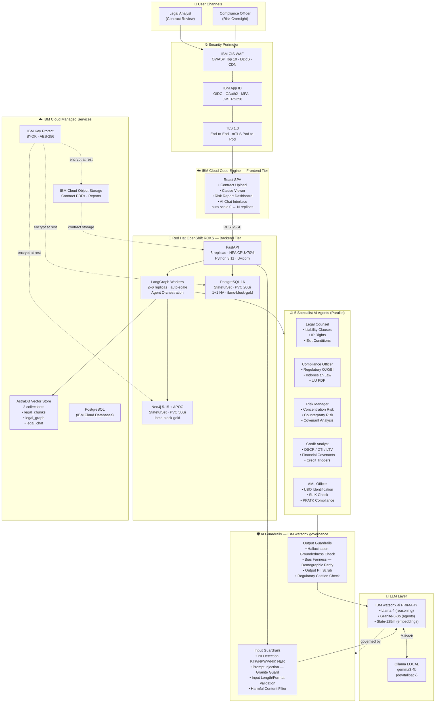
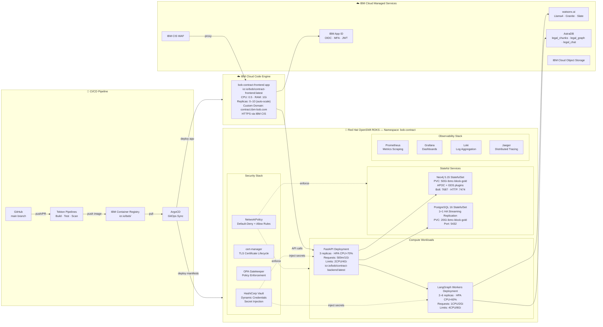
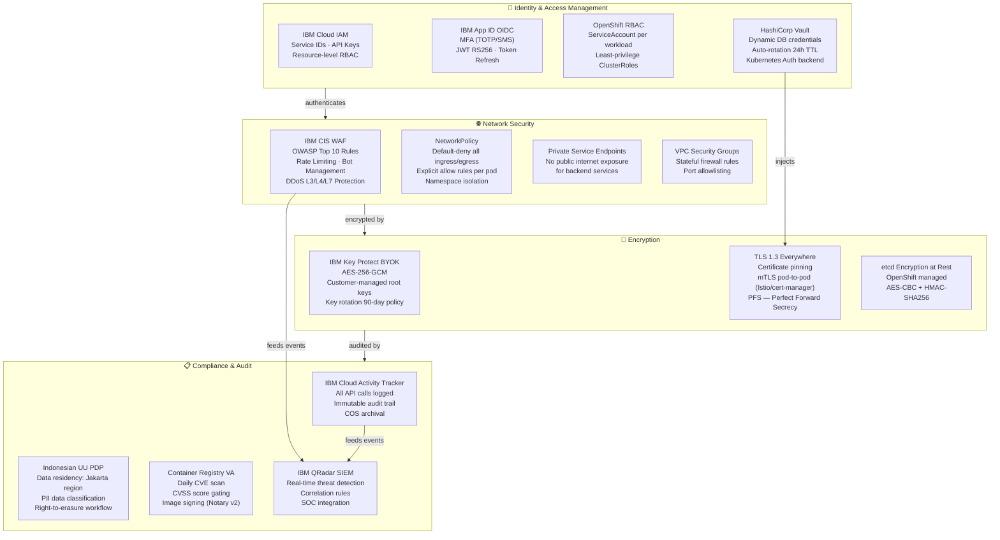
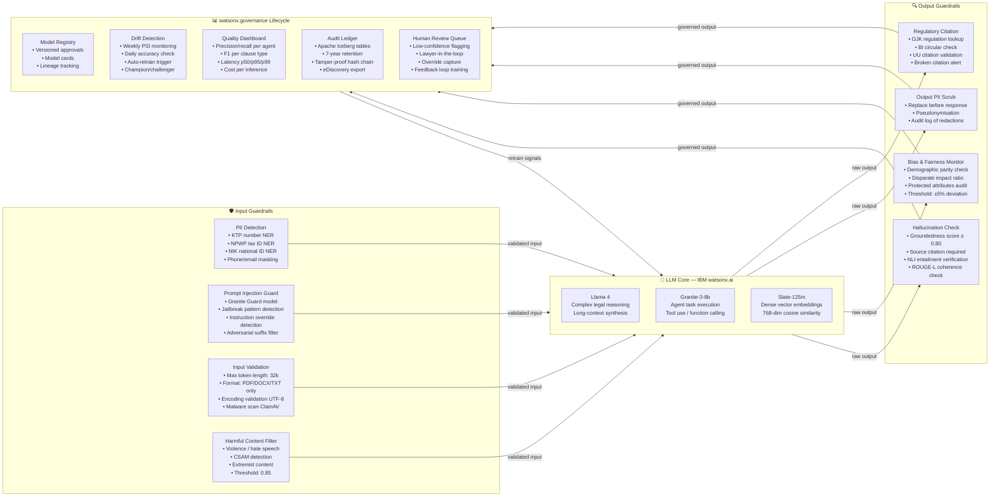
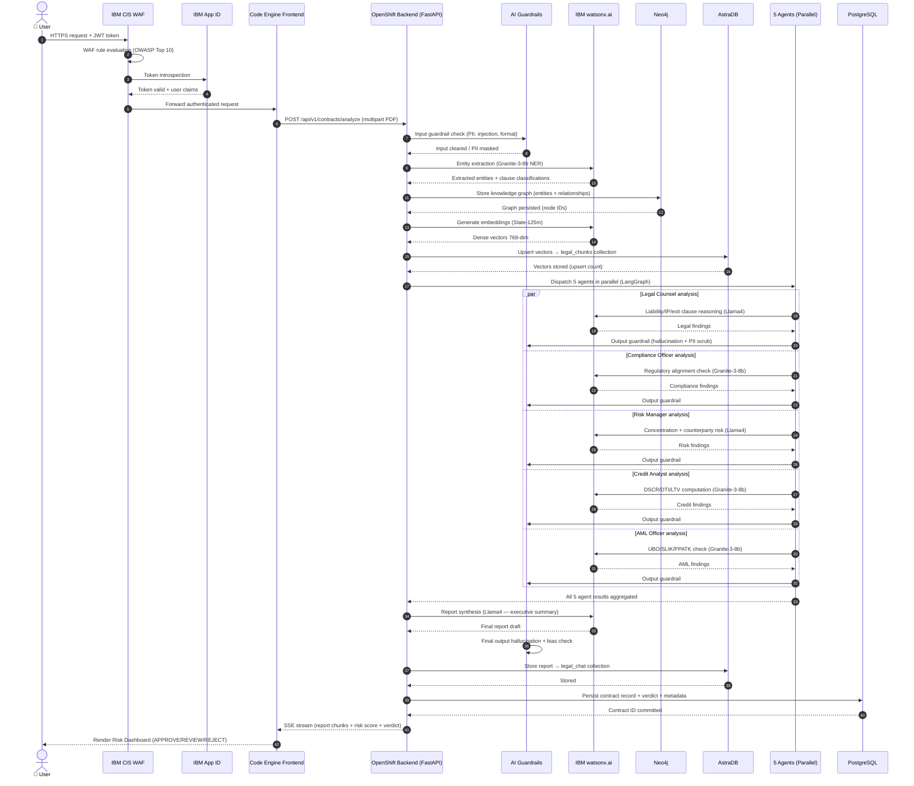

# Contract AI Legal Analyst — Solution Architecture

> **Platform**: Multi-agent AI platform for automated legal contract review, risk scoring, and knowledge graph extraction
> **Stack**: FastAPI · React/TypeScript · PostgreSQL · Neo4j · AstraDB · IBM watsonx.ai · Docling OCR · LangGraph
> **Deployment**: IBM Cloud Code Engine (frontend) + Red Hat OpenShift ROKS (backend) + IBM Managed Services

---

## 1. Full System Architecture

---

## 2. Deployment Topology

---

## 3. Security Architecture

---

## 4. AI Guardrails & Governance

---

## 5. Agent Mesh & Contract Analysis Pipeline

```mermaid
flowchart TB
    %% ─────────────────────────────────────────
    %% INPUT
    %% ─────────────────────────────────────────
    DOC["📄 Document Input\nPDF · DOCX · TXT\nMax 200 pages · 50MB"]

    %% ─────────────────────────────────────────
    %% STAGE 1: EXTRACTION
    %% ─────────────────────────────────────────
    subgraph S1["Stage 1 — Document Extraction"]
        MUP["PyMuPDF\nNative PDF text\nLayout preservation"]
        DCL["Docling OCR\nScanned documents\nTable extraction\nHandwriting support"]
    end

    %% ─────────────────────────────────────────
    %% STAGE 2: CHUNKING
    %% ─────────────────────────────────────────
    subgraph S2["Stage 2 — Clause Chunking (18 Clause Types)"]
        CH["Semantic Chunker\nMax 1024 tokens/chunk\nClause boundary detection\nTypes: Parties · Definitions · Term · Payment\nLiability · IP · Confidentiality · Termination\nForce Majeure · Dispute · Governing Law · SLA\nWarranty · Indemnity · Amendment · Assignment\nData Protection · Compliance"]
    end

    %% ─────────────────────────────────────────
    %% STAGE 3: KNOWLEDGE GRAPH
    %% ─────────────────────────────────────────
    subgraph S3["Stage 3 — Knowledge Graph (Neo4j)"]
        EN["14 Entity Types\nPARTY · OBLIGATION · AMOUNT · RATIO\nASSET · COVENANT · PENALTY · SLA_METRIC\nDATE · REGULATION · RISK_FLAG · CONDITION\nIP · JURISDICTION"]
        RL["12 Relationship Types\nOWES_TO · TRIGGERS · SECURES · REFERENCES\nGOVERNS · MODIFIES · EXCLUDES · REQUIRES\nASSIGNS · TERMINATES · INDEMNIFIES · AUDITS"]
    end

    %% ─────────────────────────────────────────
    %% STAGE 4: CLASSIFY
    %% ─────────────────────────────────────────
    subgraph S4["Stage 4 — Document Classification"]
        CL["Contract Type Classifier\nGranite-3-8b zero-shot\nTypes: Loan · Vendor · Employment\nLease · Partnership · NDA · M&A"]
    end

    %% ─────────────────────────────────────────
    %% STAGE 5: PARALLEL AGENTS
    %% ─────────────────────────────────────────
    subgraph S5["Stage 5 — 5 Specialist AI Agents (Parallel LangGraph)"]
        AG1["⚖️ Legal Counsel\n• Liability clause analysis\n• IP rights & ownership\n• Exit conditions & penalties\n• Jurisdiction enforceability"]
        AG2["📋 Compliance Officer\n• OJK regulatory alignment\n• Bank Indonesia circulars\n• UU PDP data protection\n• AML/CFT requirements"]
        AG3["⚠️ Risk Manager\n• Concentration risk score\n• Counterparty credit risk\n• Covenant sensitivity analysis\n• Cross-default triggers"]
        AG4["💳 Credit Analyst\n• DSCR calculation\n• DTI ratio assessment\n• LTV covenant check\n• Amortisation schedule risk"]
        AG5["🔍 AML Officer\n• UBO identification\n• SLIK credit history\n• PPATK transaction flags\n• Beneficial ownership graph"]
    end

    %% ─────────────────────────────────────────
    %% AGGREGATION
    %% ─────────────────────────────────────────
    AGG["📊 Findings Aggregation\nSeverity: CRITICAL → HIGH → MEDIUM → LOW\nDeduplication · Conflict resolution\nConsensus scoring across agents"]

    %% ─────────────────────────────────────────
    %% STAGE 6: REPORT
    %% ─────────────────────────────────────────
    subgraph S6["Stage 6 — Report Generation"]
        RPT["Executive Summary\nRisk Score 0–100\nVerdict: APPROVE / REVIEW / REJECT\nPDF + JSON export\nSSE stream to frontend"]
    end

    DOC --> S1
    S1 --> S2
    S2 --> S3
    S3 --> S4
    S4 --> S5
    S5 --> AGG
    AGG --> S6
```

---

## 6. Data Flow Sequence

---

## Tech Stack Reference

| Layer | Technology | Runtime | Notes |
|---|---|---|---|
| **Frontend** | React 18 + Vite + Tailwind CSS | IBM Cloud Code Engine | Auto-scale 0→10 replicas · CPU 0.5 · RAM 1Gi |
| **API Gateway** | FastAPI + Uvicorn | OpenShift 3 replicas | HPA CPU>70% · Limits 2CPU/4Gi · Python 3.11 |
| **Agent Orchestration** | LangGraph + LangChain | OpenShift workers 2–6 | Parallel agent execution · StateGraph |
| **Primary LLM** | IBM watsonx.ai — Llama 4 | IBM Cloud SaaS | Complex reasoning · 128k context |
| **Agent LLM** | IBM watsonx.ai — Granite-3-8b | IBM Cloud SaaS | Tool use · function calling · low latency |
| **Embeddings** | IBM watsonx.ai — Slate-125m | IBM Cloud SaaS | 768-dim dense vectors · cosine similarity |
| **Local LLM** | Ollama — gemma3:4b | Local / dev | Dev fallback · no internet required |
| **OCR / Extraction** | Docling OCR + PyMuPDF | OpenShift | Scanned PDF · tables · handwriting |
| **Knowledge Graph** | Neo4j 5.15 + APOC + GDS | OpenShift StatefulSet | 14 entity types · 12 rel types · PVC 50Gi |
| **Vector Store** | AstraDB (DataStax) | IBM Cloud SaaS | 3 collections: legal_chunks · legal_graph · legal_chat |
| **Relational DB** | PostgreSQL 16 | OpenShift StatefulSet | 1+1 HA · PVC 20Gi · ibmc-block-gold |
| **Auth / SSO** | IBM App ID OAuth2 / OIDC | IBM Cloud SaaS | MFA · JWT RS256 · token introspection |
| **Secrets** | HashiCorp Vault | OpenShift | Dynamic credentials · K8s auth · 24h TTL |
| **WAF / CDN** | IBM Cloud Internet Services (CIS) | IBM Cloud | OWASP Top 10 · DDoS · rate limiting |
| **AI Governance** | IBM watsonx.governance | IBM Cloud SaaS | Drift · bias · hallucination · audit ledger |
| **Observability** | Prometheus + Grafana + Loki + Jaeger | OpenShift | Metrics · logs · traces · dashboards |
| **CI/CD** | Tekton Pipelines + ArgoCD | OpenShift | GitOps · image scanning · auto-deploy |
| **Container Registry** | IBM Container Registry (ICR) | IBM Cloud | Vulnerability Advisor · image signing |
| **Key Management** | IBM Key Protect | IBM Cloud | BYOK · AES-256 · 90-day rotation |
| **Object Storage** | IBM Cloud Object Storage (COS) | IBM Cloud | Contract PDFs · report archives |
| **Policy Engine** | OPA Gatekeeper | OpenShift | Admission control · policy-as-code |
| **TLS Certs** | cert-manager | OpenShift | ACME · auto-renewal · mTLS |
| **Data Governance** | Apache Iceberg + Audit Ledger | OpenShift | 7-year immutable retention · eDiscovery |

---

## Architecture Decision Records (ADR)

| # | Decision | Rationale |
|---|---|---|
| ADR-001 | IBM watsonx.ai over OpenAI GPT-4 | Data residency, IBM Cloud SLA, BYOK encryption, no training on customer data |
| ADR-002 | Neo4j Knowledge Graph for contract entities | Relationship traversal for cross-clause risk detection outperforms relational joins |
| ADR-003 | LangGraph over LangChain LCEL for orchestration | Cyclic graph support, parallel branch execution, built-in state checkpointing |
| ADR-004 | Code Engine for frontend, OpenShift for backend | Stateless frontend benefits from scale-to-zero; stateful AI/DB workloads need persistent pods |
| ADR-005 | AstraDB for vector store | Serverless scaling, multi-collection isolation, native LangChain integration |
| ADR-006 | 5 specialist agents over monolithic LLM | Reduced hallucination per domain, parallel execution 5× speedup, domain-specific prompts |
| ADR-007 | HashiCorp Vault for secrets | Dynamic credential rotation eliminates static secrets; K8s auth backend avoids root tokens |
| ADR-008 | IBM watsonx.governance for AI lifecycle | Regulatory compliance (Indonesian OJK/BI AI governance guidelines), drift alerting, audit ledger |
