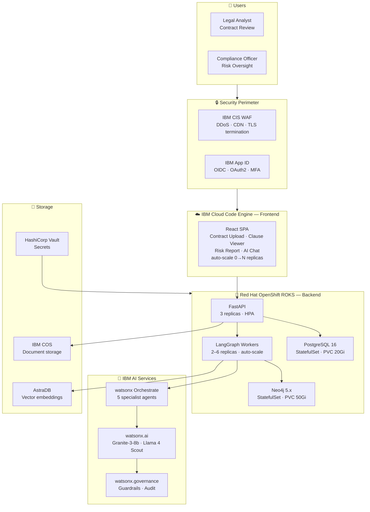
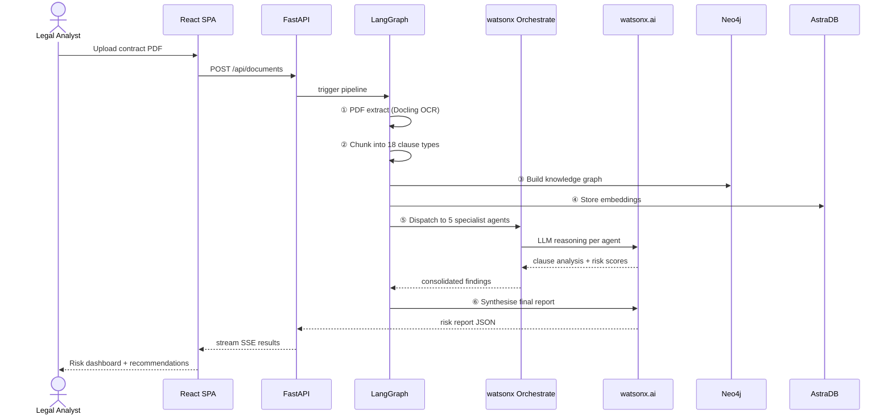
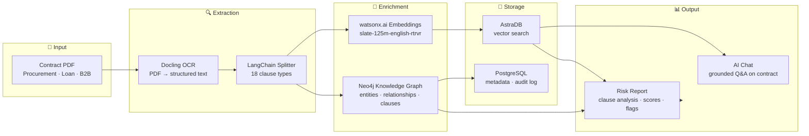
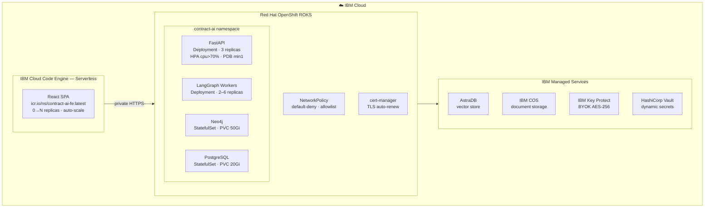
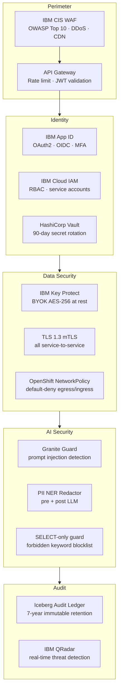
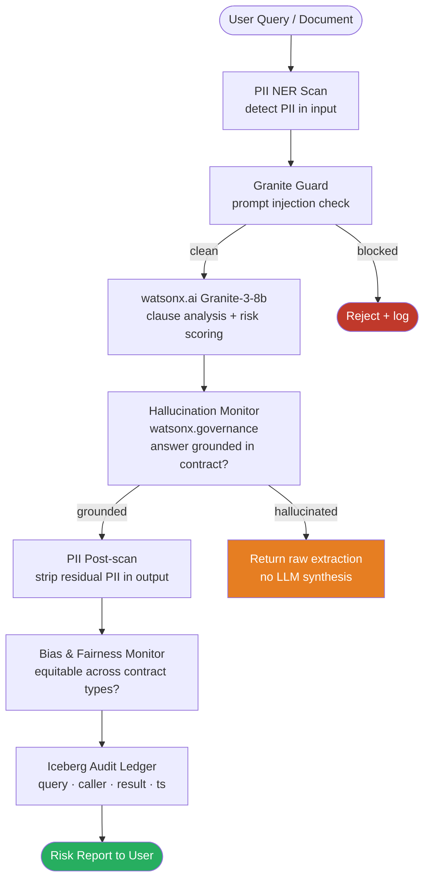
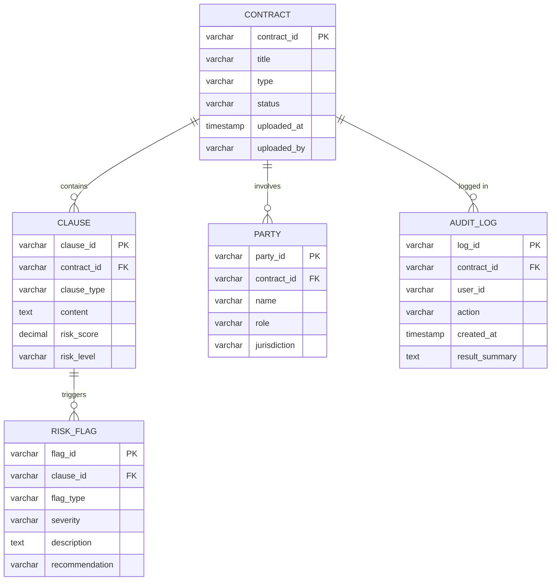

# Solution Architecture — Contract AI Legal Analyst
### Multi-agent contract review · Risk scoring · Knowledge graph extraction
**Stack:** FastAPI · React/TypeScript · Neo4j · AstraDB · IBM watsonx.ai · LangGraph · Docling OCR

---

## 1. Full System Architecture

---

## 2. Agent Pipeline Flow

---

## 3. Data Pipeline

---

## 4. Deployment Topology

---

## 5. Security Architecture

---

## 6. AI Guardrails & Governance

---

## 7. Data Model

